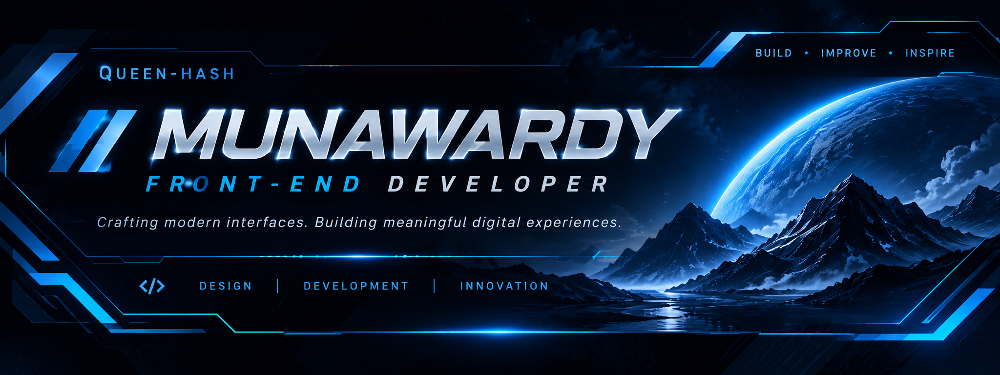

  

 

  
  &nbsp;&nbsp;
  

  

 

  
    
  <h3>Hi, I'm Munawardy — Front-End Developer</h3>
  

    I specialize in crafting <b>clean, responsive, and interactive web experiences</b>. 
    By combining thoughtful UI design with practical front-end engineering, I turn complex ideas into digital products that feel fast, intuitive, and enjoyable to use.
  

  

    <code>Modern Web Dev</code> &nbsp;•&nbsp;
    <code>Interactive UI &amp; Animations</code> &nbsp;•&nbsp;
    <code>Performance Optimization</code> &nbsp;•&nbsp;
    <code>New Technologies</code>
  

 

  

**Frontend Development**  

**Backend, Database & BaaS**  

**Tools & Deployment**  

 

  

 

| No | Project | Description | Tech Stack | Link |
| :---: | :--- | :--- | :--- | :---: |
| **01** | **Personal Portfolio** | Personal website showcasing selected projects, dev journey, and UI experiments. | `Next.js` `Tailwind` `Framer Motion` |  |
| **02** | **Prime Property Agency** | Modern property listing platform with responsive interface and database backend. | `Next.js` `TypeScript` `Supabase` |  |
| **03** | **Finly Budget Planner** | Personal finance app for budgeting, expense tracking, and financial organization. | `React` `JavaScript` `Tailwind` |  |

 

## GITHUB STATISTICS

  
  
   
  

 

  

